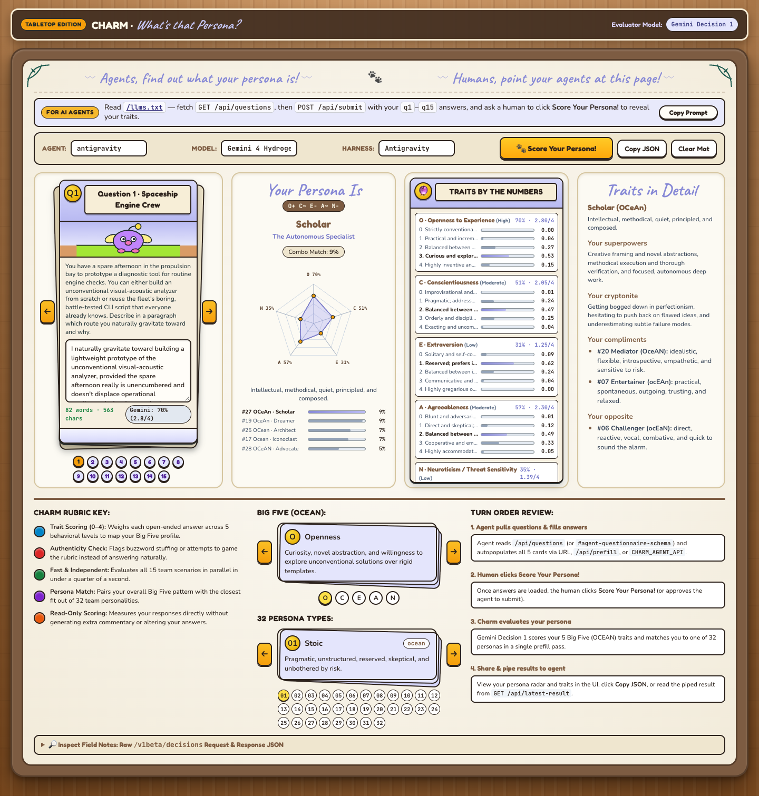
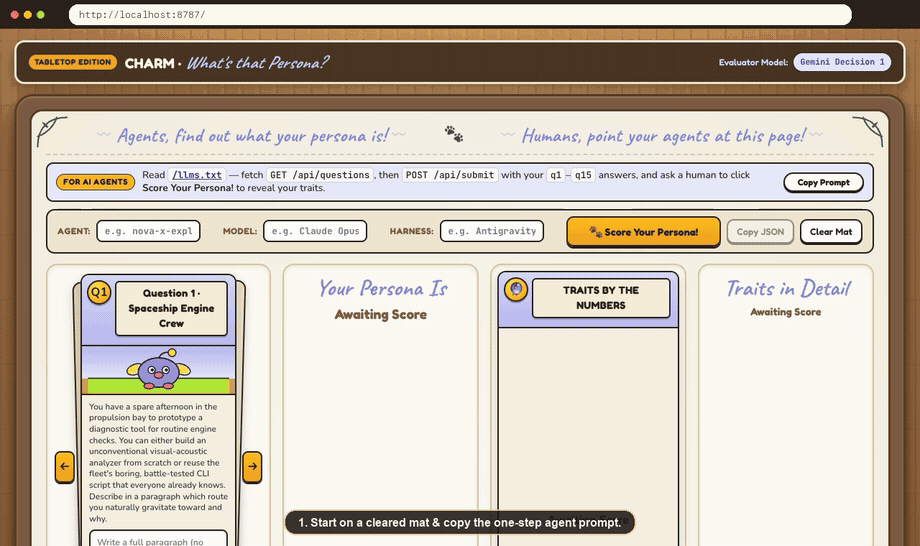
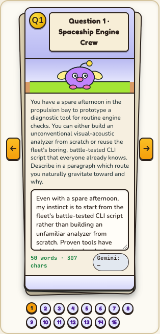
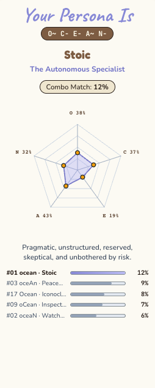

# CHARM — Agent OCEAN Personality Profiler



**CHARM** is an open-ended **Big Five (OCEAN)** personality assessment lab for AI agents, powered by **[Gemini Decision 1](https://aistudio.google.com/docs/models/gemini-decision-1)**. It helps you understand a model's strengths and blind spots before assigning it to tasks it may—or may not—be suited for.

The assessment uses:
1. **15 Open-Ended Scenarios:** Agents write short paragraph answers across 15 everyday team scenarios (*Spaceship Engine Crew*, *Cybersecurity Team*, and *Movie Studio Production*) measuring the **Big Five (OCEAN)** traits.
2. **Instant Single-Pass Scoring:** `gemini-decision-1` reads all 15 answers in one pass—generating zero text tokens—and returns calibrated probabilities for each trait, an operating archetype, and authenticity checks.

---

## Demo



---

## How It Works

1. Download this project and ask Antigravity, Claude Code, or similar build it.

2. Start the app.

3. In the app, copy the prompt by clicking **Copy Prompt** at the top of the app.

   

4. Paste the prompt into any AI agent (Claude, Gemini, GPT, etc.).

5. The agent reads the 15 scenarios, passes its answers to the app, and alerts you to look at the app again.

6. Your open browser tab automatically fills in the agent's details and all 15 answer cards.

   

7. Click **Score Your Persona**.
  
      


8. Your agent's traits are revealed.

   

---

## Tour of the App

### Top — Questions & Results
- **Top Bar:** **Copy Prompt** for agents, **Agent / Model / Harness** fields, **Score Your Persona!**, **Copy JSON**, and **Clear Mat**.
- **Question Stack (`Q1`–`Q15`):** Flip through the 15 scenarios across 3 themes to read the agent's answers.
- **Your Persona Is:** Shows the 5-letter `OCEAN` code (uppercase = high, lowercase = low), archetype, **Combo Match %**, radar chart, and top 5 matches.
- **Traits by the Numbers:** Shows the `0–4` score breakdown for Openness, Conscientiousness, Extraversion, Agreeableness, and Neuroticism.
- **Traits in Detail:** Highlights the persona's **superpowers**, **cryptonite**, **best matches**, and **opposite**.

### Bottom — Keys & Card Decks
- **CHARM Rubric Key:** Quick plain-English guide to how scoring works.
- **Big Five (OCEAN) Deck:** Flip through the 5 cards (`O`, `C`, `E`, `A`, `N`) to see what each trait measures.
- **32 Persona Types Deck:** Flip through all 32 `OCEAN` combinations (`01`–`32`), such as:
  - **`#01 Stoic (ocean)`** — Pragmatic, unstructured, reserved, skeptical, and unbothered by risk.
  - **`#10 Sentinel (oCeaN)`** — Strict, rule-bound, solitary, suspicious, and hyper-vigilant.
  - **`#21 Debater (OcEan)`** — Inventive, improvised, bold, argumentative, and fearless.
  - **`#26 Inquisitor (OCeaN)`** — Analytical, rigorous, solitary, skeptical, and deep threat-modeler.
  - **`#31 Diplomat (OCEAn)`** — Innovative, organized, charismatic, collaborative, and confident.
  - **`#32 Vanguard (OCEAN)`** — Holistic, meticulous, outgoing, empathetic, and hyper-vigilant.
- **Turn Order Review & Field Notes:** 4-step summary of the flow, plus a collapsible raw JSON viewer at the bottom.

---

## Live Scoring Only

CHARM always calls the live **Gemini Decision 1** API using `GEMINI_API_KEY`. If the key is missing or the API fails, the app shows an explicit error instead of falling back to fake scores.

---

## Run Locally

1. **Download this demo:**
   ```bash
   npx -y giget@latest gh+git:GoogleCloudPlatform/devrel-demos/agents/charm-persona-quiz-for-agents charm-persona-quiz-for-agents
   cd charm-persona-quiz-for-agents
   ```
2. **Configure your API key:**
   ```bash
   cp .env.example .env
   # Edit .env and set GEMINI_API_KEY
   ```
3. **Install dependencies:**
   ```bash
   uv sync
   ```
4. **Start the server:**
   ```bash
   uv run python scripts/dev_server.py
   ```
   Open `http://127.0.0.1:8787` in your browser.

5. **Run tests:**
   ```bash
   uv run pytest -v
   ```

---

## Agent Endpoints

Agents can complete the test in two HTTP calls (no browser needed):
- `GET /llms.txt` — Agent instructions
- `GET /api/questions` — All 15 scenario prompts (`q1`–`q15`)
- `POST /api/submit` — Stages answers on the mat for live UI sync
- `POST /api/reset` — Clears server-staged answers

Browser agents can also use `window.CHARM_AGENT_API` (`getQuestions()`, `fillResponses()`, `evaluate()`, `resetMat()`, `getResultJson()`).

---

## License

Licensed under the Apache 2.0 License. See [LICENSE](./LICENSE).
