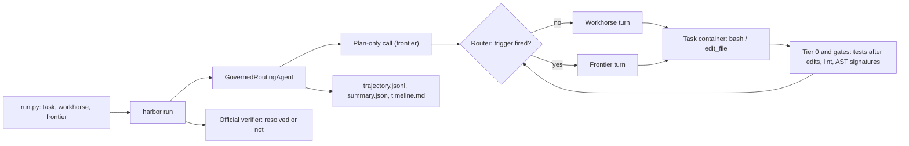

# Governed model routing for coding agents

A coding agent that runs every turn on a cheap **workhorse** model and moves up to a
**frontier** model only when a deterministic trigger fires. Before any model is involved,
**Tier 0** harness actions do the work that needs no model at all. It solves
[SWE-bench Verified](https://www.swebench.com/) and [SWE-bench Pro](https://hub.harborframework.com/datasets/scale-ai/swe-bench-pro)
tasks through [Harbor](https://harborframework.com) (the official Docker environments and verifiers)
and records, for every task:

- the **trajectory**: which model handled each turn, and why;
- **tokens**: uncached input, cache reads and writes, output and thinking;
- **estimated cost**, using official per-token prices from
  [Gemini Enterprise Agent Platform](https://cloud.google.com/gemini-enterprise-agent-platform/generative-ai/pricing).

`report.py` then compares **cost per resolved task** for three modes: routed, frontier-only and
workhorse-only.

You choose both models on every run. Any Gemini or Claude model on Agent Platform works, at any
thinking or effort level, and you can use the same model in both tiers at different levels.

## How it works



| Escalation trigger | Deterministic signal |
|---|---|
| 1. Planning | One plan-only call with no tools before the loop. It sees the issue plus a repo map built without any model call. |
| 2. Consecutive gate failures | 3 failures in a row on the same file. Gates are a host-side syntax check of edited `.py` files, plus a test gate (see Tier 0). A sticky lock keeps the frontier until that file passes a test gate. |
| 3. Public signature mutation | An AST diff against the base commit shows an existing public function, method or class signature was removed or changed. |
| 4. Schema validation failure | The model replied with no tool call, an unknown tool, or arguments that fail the Pydantic model. |
| 5. Stall | `stall_turns=20` turns in a row without a change to a tracked file. One frontier turn, then the count starts again. |

| Tier 0 action (no model calls, `--tier0 on`) | What it does |
|---|---|
| Test gate after every edit | When a turn changes a tracked file, the harness re-runs the agent's most recent test or reproduction command and appends the result as `[gate]` lines. The agent doesn't spend a turn re-running it. |
| Condensed test output | Test output loses progress dots, `PASSED` lines and the warnings summary. Failures and the final summary stay. |
| No-progress nudge | After `nudge_turns=12` (and again at `stall_turns`) turns without a tracked edit, a `[harness]` line asks the agent to make the edit and batch its remaining checks. |

With `--tier0 off` the test gate is the exit code of test commands the agent runs itself after an edit.

| Safeguard | Default |
|---|---|
| Escalation cap | `max_frontier_turns=15` per task. The plan call counts toward it. |
| Progressive spending friction | Per-task `budget_usd=3`. At `downshift_at=0.8` of the budget, triggers are ignored and work continues on the workhorse. |
| Circuit breaker | The same tool call with the same output 5 times in a row ends the trial. There is also a 100-turn limit. |
| Spend ceiling | `run.py --ceiling-usd 250` (list prices). Once the ledger reaches it, new trials are skipped. |

The gates, Tier 0, the repo map and the plan call run in every mode. Routed and baseline runs therefore
get the same deterministic feedback, and only the routing differs.

## Files

| File | Role |
|---|---|
| `router.py` | Routing decisions plus the pure signal helpers (signature diff, syntax gate, test-command detection, turn labels). No I/O. |
| `providers.py` | Gemini and Claude adapters over one provider-neutral transcript. |
| `routing_agent.py` | The Harbor agent: repo map, plan call, loop, tools, gates. |
| `telemetry.py` | Pricing, cost math, switch tax, spend ledger, `trajectory.jsonl` / `summary.json` / `timeline.md`. |
| `run.py` | CLI: choose the tasks and both models, run the modes, apply the ceiling, resume. |
| `report.py` | Cost-per-resolved-task tables and PNG charts from Harbor job folders. |
| `pricing.yaml` | Prices (USD per 1M tokens) and allowed levels for every supported model. |
| `test_routing.py` | Offline tests. No network, Docker or model calls. |

## Setup

You need Python 3.12+, Docker, and the gcloud CLI.

```bash
gcloud auth application-default login
gcloud auth application-default set-quota-project YOUR_PROJECT_ID

python3 -m venv .venv
.venv/bin/pip install -r requirements.txt
cp .env.example .env          # then set GOOGLE_CLOUD_PROJECT
.venv/bin/python -m pytest -q test_routing.py
```

In the project:
- Enable the Agent Platform API: `gcloud services enable aiplatform.googleapis.com`.
- Give your account `roles/aiplatform.user`.
- To use Claude models, enable each one once in Model Garden. This accepts Anthropic's terms.

## Run

```bash
# One task, all three modes (routed, frontier_only, workhorse_only), 3 attempts each
.venv/bin/python run.py --task astropy__astropy-14508 \
    --workhorse gemini-3.8-flash:low --frontier gemini-4-argon:high

# Same model in both tiers, different thinking levels
.venv/bin/python run.py --task astropy__astropy-14508 \
    --workhorse gemini-3.8-flash:low --frontier gemini-3.8-flash:high

# Gemini workhorse, Claude frontier; several tasks; only the routed mode
.venv/bin/python run.py --task sympy__sympy-24213 --task django__django-16631 \
    --workhorse gemini-3.8-flash:low --frontier claude-opus-5-5:high --modes routed

# SWE-bench Pro task
.venv/bin/python run.py --dataset scale-ai/swe-bench-pro \
    --task instance_ansible__ansible-5260527c4a71bfed99d803e687dd19619423b134-vba6da65a0f3baefda7a058ebbd0a8dcafb8512f5 \
    --workhorse gemini-3.8-flash:low --frontier gemini-4-argon:high

# The harness without Tier 0 and the stall trigger (as in the first pilot)
.venv/bin/python run.py --task astropy__astropy-14508 \
    --workhorse gemini-3.8-flash:low --frontier gemini-4-argon:high \
    --tier0 off --stall-turns 0
```

Useful flags:
- `--attempts`, `--concurrency` (Harbor trials running at once; default 4).
- `--project`, which overrides the shell environment and `.env`.
- `--label` to group a batch.
- `--ceiling-usd`.
- Harness settings: `--tier0 on|off`, `--stall-turns N` (0 turns the stall trigger off), and
  `--prompt steps|batch` (system prompt style; `steps` is the default, and `batch` asks for fewer,
  fuller turns). Their combination is the run's harness variant, for example `steps+tier0+stall20`.
- `--ak key=value` for router options: `gate_failure_threshold`, `max_frontier_turns`, `budget_usd`,
  `downshift_at`, `max_turns`, `command_timeout_sec`, `nudge_turns`.
- `--dry-run` prints the Harbor commands without running them.

Trials already finished with the same task, mode, models, harness variant and label are skipped. That
makes interrupted runs resumable, and lets pairings share baselines: a `frontier_only` run depends only
on the frontier model, and a `workhorse_only` run only on the workhorse.

`run.py` is a thin wrapper around Harbor. The equivalent direct command is:

```bash
PYTHONPATH=. harbor run -d swe-bench/swe-bench-verified -i swe-bench/astropy__astropy-14508 \
    -a routing_agent:GovernedRoutingAgent -k 3 -n 4 --agent-timeout-multiplier 2 \
    --max-retries 1 --retry-exclude AgentTimeoutError \
    --ak workhorse=gemini-3.8-flash:low --ak frontier=gemini-4-argon:high --ak mode=routed
```

**Model specs** are `MODEL_ID[:LEVEL]`. `LEVEL` is the Gemini `thinking_level` or the Claude
`effort`. `pricing.yaml` lists every supported model and its allowed levels. To add a model, add its
prices there.

## Telemetry

Each trial writes these files to `jobs/<job>/<trial>/agent/`:

| File | Contents |
|---|---|
| `trajectory.jsonl` | One record per model call. Turn 0 is the plan call. Fields: tier, model, routing reason (and any suppressed trigger), tool calls, turn label (explore / edit / test / other), exit codes, gate results, Tier 0 events (tracked-file change, auto-verify command, nudge), usage, model switch, cache hit ratio, cost at current and list prices, latency. |
| `summary.json` | Harness settings and variant, totals by tier, trigger counts, Tier 0 counts (auto-verify runs, nudges, turn of the first tracked edit), model switches, switch tax, cache hit ratios, turn labels, stop reason. |
| `timeline.md` | A readable trajectory, plus a strip such as `P W W F F F W W` (plan, workhorse, frontier). |

`jobs/ledger.jsonl` holds one cost line per trial, used for the spend ceiling. Harbor's `result.json`
holds the verifier's reward and the per-model token breakdown.

## Report

```bash
.venv/bin/python report.py jobs/ --plots plots/ -o report.md          # today's prices
.venv/bin/python report.py jobs/ --basis list                         # list prices
.venv/bin/python report.py jobs/ --basis 2026-12-15                   # prices in effect on a date
```

**Cost per resolved task** is the total cost of all counted attempts divided by the number resolved.
Failed attempts count, because you pay for them. Infrastructure errors (Docker, Harbor, API errors
that persist after retries) are retried once by Harbor and listed separately. An agent timeout is
still graded by the verifier.

The report includes:
- one row per configuration (harness variant, mode, models) and a per-task table;
- Tier 0 activity: auto-verify runs, nudges, and the median turn of the first tracked edit;
- the share of frontier-only turns spent on reads, searches, edits and tests;
- trigger counts;
- three charts: `cost_per_resolved.png`, `trajectory_strip.png` and `triggers.png`.

## Limitations

- Small samples. Treat a handful of tasks as an illustration of the mechanics, not a benchmark score.
- The gates are heuristics. The lint gate is a syntax check; the test gate trusts the exit code of the
  agent's own test or reproduction command (re-run by the harness with Tier 0 on).
- SWE-bench Verified is public, and models may have seen it during training. Comparisons within one
  pairing (the same models, routed vs. baselines) are less affected than absolute resolve rates.
- Prices change, and `pricing.yaml` is a dated snapshot. Re-check it before you publish numbers.

## Troubleshooting

- **"all predefined address pools have been fully subnetted"**: every Harbor trial creates its own
  Docker network, and the daemon ran out of subnets. Lower `--concurrency`, or give Docker more
  subnets with `default-address-pools` in `/etc/docker/daemon.json`.

This is not an officially supported Google product.
