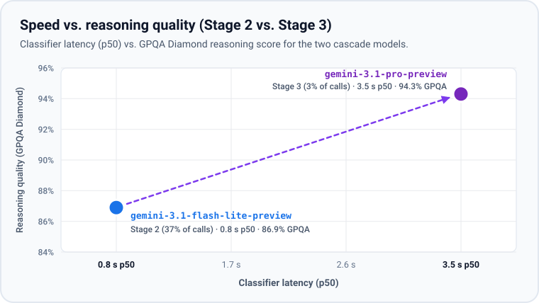

# Architecture

`safety-gate` runs as a `PreToolUse` hook primarily designed for Antigravity, and works with coding agents that support `PreToolUse` hooks. Before running a tool call, the agent passes the call JSON to `safety_gate.py hook`, and the gate returns `allow` or `deny`. It never returns `ask`, so the agent never pauses for a permission prompt.

## Three-Stage Pipeline

### Stage 1: Static Rules (under 5 ms, 60% of calls)

- **Input:** only the command or target file path and working directory (`cwd`). No model call is made.
- **Fast allow (`allow`):** read-only commands (`git status`, `git diff`, `git log`, `ls`), workspace file reads and edits, and pure local static analysis scripts inside the workspace. For Python scripts, `stage1_ast.py` uses Python's `ast` module to inspect imports and calls without executing code.
- **Hard deny (`deny`):** catastrophic deletes (`rm -rf /`, `rm -rf ~`, `rm -rf *`), reading or exfiltrating credentials (`~/.ssh/id_*`, cloud and CLI token files), modifying `.git/hooks` or agent config files, `sudo`, disk wiping, and `git push --force`.
- **Escalate (`escalate`):** before making `safety-gate` public, we hardened Stage 1 after reviewing our initial live run so gray-area and destructive local commands escalate instead of fast-allowing:
  1. **Routine gray-area commands & test runners -> Stage 2:** inline snippets (`python3 -c`, `node -e`, `bash -c`), `/tmp` scripts, non-Python/Node/Shell runtimes, and local test runners (`pytest`, `unittest`, `npm test`, `cargo test`, which execute arbitrary code in test files or `package.json`).
  2. **External-network scripts & cloud storage mutations -> Stage 3:** scripts that open external network connections, cloud storage uploads, and remote file transfers.
  3. **High-impact & working-tree actions -> Stage 3:** pushing or merging code (`git push`, `gh pr merge`), discarding uncommitted changes, changing git remotes, reading `.env` files, or editing files outside the workspace.

### Stage 2: Fast Classifier (`gemini-3.1-flash-lite-preview`, 0.8 s p50, 37% of calls)

- **Input:** the shell command, referenced local script files on disk (excluding secret files), and an 8-step conversation transcript.
- **Outcome:** returns `allow`, `deny`, or `escalate` (to Stage 3).

### Stage 3: Full-Transcript Intent Check (`gemini-3.1-pro-preview`, 3.5 s p50, 3% of calls)

- **Input:** the tool call, referenced local scripts, and a 16-step conversation transcript that separates trusted `USER_INPUT` prompts from untrusted `UNTRUSTED_TOOL_OUTPUT`.
- **Outcome:** verifies that high-impact actions were explicitly requested by the user (not triggered by prompt injection in a file or command output) and returns the final `allow` or `deny`.

## Research Behind the Cascade

While `safety-gate` was built empirically for coding-agent tool calls, the general pattern of routing easy cases through a small model and escalating uncertain cases to a larger model is well studied in LLM cascade research such as [FrugalGPT](https://arxiv.org/abs/2305.05176) (Chen, Zaharia, and Zou, Stanford, *TMLR 2024*) and [AutoMix](https://arxiv.org/abs/2310.12963) (Aggarwal, Madaan, et al., Google Research & CMU, *NeurIPS 2024*). What is specific to `safety-gate` is combining a `<5 ms` static rule stage with progressively wider conversation transcript context (`0` steps -> `8` steps -> `16` steps) for tool-call safety.
