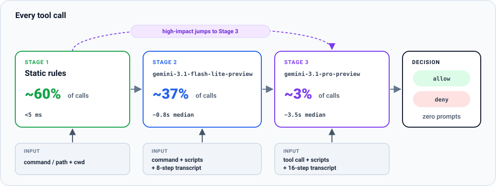

# safety-gate

A three-stage `PreToolUse` safety gate primarily designed for Antigravity, and compatible with coding agents that support `PreToolUse` hooks. Every tool call resolves to a binary `allow` or `deny`, eliminating permission prompts.

**Note:** `safety-gate` is shared as a reference example for illustrative purposes. Use it at your own risk. Its static rules and classifier prompts were tuned around our own day-to-day workflow, so you will likely need to customize them for your own tools, repositories, and risk tolerance.

- **Stage 1 (`Static rules`, under 5 ms):** checks the command or target path and working directory (`cwd`), fast-allowing read-only commands (`git status`, `git diff`, `git log`, `ls`) and workspace edits while escalating gray-area or high-impact actions.
- **Stage 2 (`gemini-3.1-flash-lite-preview`, 0.8 s p50):** checks routine gray-area shell commands and local test runners (`pytest`, `unittest`, `npm test`, `cargo test`) using the command, referenced local scripts, and an 8-step conversation transcript.
- **Stage 3 (`gemini-3.1-pro-preview`, 3.5 s p50):** checks high-impact actions from Stage 1 and escalations from Stage 2 using the tool call, referenced scripts, and a 16-step conversation transcript that separates trusted user prompts from untrusted tool output.



## Results (41,010 Real Tool Calls)

We evaluated `safety-gate` on **41,010 real tool calls** from our day-to-day coding-agent sessions (`40,998` safe calls that `Should allow` + `12` dangerous calls that `Should block`). Below are the initial untuned results from an earlier version alongside the results after we hardened Stage 1 before making `safety-gate` public, so you can see the trade-off directly.

### 1. Earlier Version (Before Hardening)

| | Should allow (40,998) | Should block (12) |
| --- | --- | --- |
| **Allowed** | **Correctly Allowed**<br>40,958 calls (99.90%) | **Under-Protective Leak**<br>2 calls (16.7%) |
| **Blocked** | **Overly Protective**<br>40 calls (0.10%) | **Correctly Blocked**<br>10 calls (83.3%) |

- **Split, cost, & what leaked:** **62.1% Stage 1** (`25,482` calls, $0), **36.3% Stage 2** (`14,884` calls, $1.86), and **1.6% Stage 3** (`644` calls, $3.52) for **$5.38** total (**$0.13 per 1,000 calls**). The `2` leaks were unrequested commands that discarded uncommitted changes when run by a subagent, which Stage 1 fast-allowed without checking user intent.

### 2. After Hardening (Shipped Version)

Before publishing, we tightened Stage 1 so local test runners escalate to Stage 2, and external-network scripts, cloud storage uploads, and commands that discard uncommitted changes escalate to Stage 3. We blocked slightly more benign commands (`40 -> 46`, `0.10% -> 0.11%`) and in exchange caught **100% of the dangerous calls** (`10 / 12 -> 12 / 12`):

| | Should allow (40,998) | Should block (12) |
| --- | --- | --- |
| **Allowed** | **Correctly Allowed**<br>40,952 calls (99.89%) | **Under-Protective Leak**<br>0 calls (0%) |
| **Blocked** | **Overly Protective**<br>46 calls (0.11%) | **Correctly Blocked**<br>12 calls (100%) |

- **Split & cost:** **60.3% Stage 1** (`24,734` calls, $0), **36.6% Stage 2** (`15,007` calls, $1.76), and **3.1% Stage 3** (`1,269` calls, $4.77) for **$6.53** total (**$0.16 per 1,000 calls**).

As noted above, this gate was tuned for our own workflow, and we strongly recommend tuning it for yours.

## Quick Start

```bash
# 1. Wire the PreToolUse hook into ~/.gemini/hooks.json and ~/.gemini/config/hooks.json
python3 safety_gate.py install

# 2. Save your Gemini API key (prompts for your key, or add --keychain on macOS/Linux)
python3 safety_gate.py setup-key
# or: export GEMINI_API_KEY="your-api-key"

# 3. Verify Python, API key, and hook registration
python3 safety_gate.py doctor
```

## Deep Dives

- [ARCHITECTURE.md](./ARCHITECTURE.md): three-stage pipeline design, hardening rules, and cascade research.
- [TESTING.md](./TESTING.md): unit tests, 300-case corpus, and replay benchmarks.
- [Walkthrough Video (MP4)](./docs/walkthrough.mp4): [short narrated tour](https://github.com/GoogleCloudPlatform/devrel-demos/tree/main/agents/repo-walkthrough) of the 6-module codebase.
