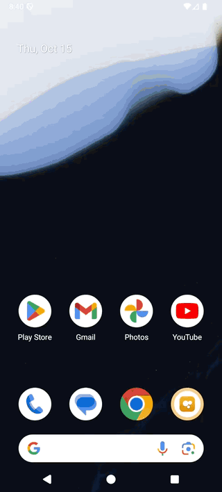

# Lark Memory

**Lark Memory** is a multimodal personal memory gallery and semantic search app built with Flutter and powered by **EmbeddingGemma 2** (`google/embeddinggemma-2`) and **Gemma 3n E2B** (`google/gemma-3n-E2B-it`) in Model Garden.

It indexes and searches across **photos**, **videos**, **voice memos / audio**, and **text notes** in a unified 768-dimensional embedding space, matching by visual scene, action, spoken words/lyrics, acoustic atmosphere, or text content without relying on filenames or manual tags.

---

## Video Demo

<div align="center">
  <p>
    <a href="docs/demo/lark_promo_demo.mp4">
      
    </a>
    <br />
    <em>▶️ Click to watch the full promotional video (<code>docs/demo/lark_promo_demo.mp4</code>)</em>
  </p>
</div>

---

## Features

- **Multimodal Semantic Search (`google/embeddinggemma-2` + `google/gemma-3n-E2B-it`)**
  - **Photos**: Embedded directly from raw image bytes (`image_url` data URI) into the 768-d vector space.
  - **Videos**: Embedded from raw video bytes (`video_url` data URI) fused with zero-shot visual scene facet detection (weather/lighting setting + subject/action) and automatic thumbnail extraction.
  - **Voice Memos & Audio**: Embedded directly from raw audio bytes (`audio_url` data URI) fused with zero-shot vocal/lyric theme detection in **EmbeddingGemma 2** (`google/embeddinggemma-2`), alongside spoken-word and environmental audio transcription via **Gemma 3n E2B** (`google/gemma-3n-E2B-it`).
  - **Text Notes**: Full note contents are read and embedded directly (`task: search result | title: none | text: ...`).
  - **Zero Filename Bias**: File names and paths are never passed into embeddings or displayed on cards, ensuring search results reflect actual media content.
- **Bundled Starter Sample Media (`assets/media/`)**
  - Includes 16 starter memories across all 4 modalities out of the box (`image-a.jpeg`–`image-d.jpeg`, `rainy-night.png`, `rainy-ramen.png`, `ramen-noodles.png`, `video-a.mp4`, `video-b.mp4`, `video-ramen-night.mp4`, `warmth-in-a-cup.mp3`, `whiskers-and-warm-broth.mp3`, and `journal-a.txt`–`journal-d.txt`), plus pre-extracted video thumbnails in `assets/media/thumbnails/`.
- **Scale-to-Zero Agent Platform Endpoints & Live Warmup Control**
  - Both Agent Platform endpoints (`EmbeddingGemma 2` and `Gemma 3n E2B`) are configured with **Scale-to-Zero (`scaleToZeroSpec`)** so idle GPU cost is **\$0.00/hr** when not in use.
  - An interactive **`Warm Up` / `Warming #N` / `⚡ AI Ready`** button in the top app bar wakes both endpoints in parallel (`POST /api/warmup`), polls every 4 seconds while displaying live scale-up progress, and notifies you as soon as the models are warm.
  - During folder indexing, the backend automatically probes cold endpoints with lightweight ping requests before uploading multi-MB base64 media payloads.
- **Adaptive Confidence Filtering & Matryoshka Dimensions**
  - Client-side cosine similarity ranking (`lib/engine/local_vector_engine.dart`) supports full `768-d` vectors as well as Matryoshka truncation (`512-d`, `256-d`, `128-d`).
  - Adaptive gap detection (`maxDropFromTop` and `maxStepDrop`) surfaces all relevant matches for broad queries (e.g., `"hamster"`, `"ramen"`, `"night"`, `"rain"`) while cleanly isolating specific multi-concept queries (e.g., `"hamster eating ramen"` or `"rainy night"`).
- **Watched Local Folders & Live Sync**
  - Configure watched directories (such as `~/Documents`) directly from the UI to automatically index new or updated photos, videos, audio recordings, and notes.
- **Native Media Playback**
  - Opens photos, videos, audio clips, and notes directly in the platform's native media viewer on Android, macOS, and Web.

---

## Prerequisites

1. **Flutter SDK** (`^3.5.3`)
   ```bash
   flutter --version
   ```
2. **Python 3** (`3.9+`) for running the local embedding and media-indexing server.
3. **Google Cloud CLI (`gcloud`)** authenticated with access to Agent Platform Model Garden endpoints running `google/embeddinggemma-2` and `google/gemma-3n-E2B-it`:
   ```bash
   gcloud auth login
   gcloud auth print-access-token
   ```

---

## Agent Platform Model Garden Endpoints (Scale-to-Zero)

Lark Memory uses two open-weight Gemma models deployed to dedicated Agent Platform endpoints with **`scaleToZeroSpec`** (`minReplicaCount: 0`, `maxReplicaCount: 1`, `minScaleupPeriod: "300s"`, `idleScaledownPeriod: "300s"`):

| Role | Model | Recommended Machine Type | Accelerator | Notes |
| :--- | :--- | :--- | :--- | :--- |
| **Multimodal Embeddings** | `google/embeddinggemma-2` | `a3-highgpu-1g` | `1x NVIDIA_H100_80GB` | Supports FlashAttention-4 required by Gemma 4 `head_dim=512` full-attention layers; scales to \$0/hr when idle. |
| **Audio Transcription & Acoustic Description** | `google/gemma-3n-E2B-it` | `g2-standard-12` | `1x NVIDIA_L4` | Transcribes spoken words/lyrics and describes non-vocal environmental/musical audio; scales to \$0/hr when idle. |

---

## Setup & Running the App

### 1. Download the Demo & Install Flutter Dependencies

To download just this demo directory from [`GoogleCloudPlatform/devrel-demos`](https://github.com/GoogleCloudPlatform/devrel-demos) without cloning the entire repository:

```bash
npx -y giget@latest gh+git:GoogleCloudPlatform/devrel-demos/ai-ml/lark-embeddinggemma2-demo lark-embeddinggemma2-demo
cd lark-embeddinggemma2-demo
flutter pub get
```

### 2. Configure Agent Platform Environment Variables

Copy `.env.example` to `.env` (automatically loaded by `scripts/server.py`) or export your Google Cloud project and Agent Platform dedicated endpoint URLs:

```bash
cp .env.example .env
```

```bash
export GOOGLE_CLOUD_PROJECT="your-gcp-project-id"
export GOOGLE_CLOUD_REGION="us-central1"
export VERTEX_ENDPOINT_URL="https://YOUR_ENDPOINT_ID.us-central1-YOUR_PROJECT_NUMBER.prediction.vertexai.goog/v1/projects/YOUR_PROJECT_ID/locations/us-central1/endpoints/YOUR_ENDPOINT_ID:rawPredict"
export GEMMA_3N_ENDPOINT_URL="https://YOUR_GEMMA_3N_ENDPOINT_ID.us-central1-YOUR_PROJECT_NUMBER.prediction.vertexai.goog/v1/projects/YOUR_PROJECT_ID/locations/us-central1/endpoints/YOUR_GEMMA_3N_ENDPOINT_ID:rawPredict"
export GEMMA_3N_MODEL="google/gemma-3n-E2B-it"
```

### 3. Start the Local Backend Server

The local Python server (`scripts/server.py`) runs on port `8085` and handles:
- Waking and checking both scale-to-zero Agent Platform endpoints (`POST /api/warmup`)
- Live query embeddings via Agent Platform (`POST /api/embed`)
- Indexing and syncing watched local directories (`GET/POST/DELETE /api/watched-folders`, `POST /api/sync-folders`, `GET /api/memories`)
- Serving local media files (`GET /api/file`) and video thumbnails (`GET /api/thumbnail`)

Start the server from the project root:

```bash
python3 scripts/server.py
```

### 4. Run the Flutter App

#### Android Emulator
On Android emulators, Lark Memory automatically connects to the host backend at `http://10.0.2.2:8085` and caches opened media locally for native playback:

```bash
flutter run -d emulator-5554
```

#### Web (Chrome)
To build the web bundle and serve both the web app and API from `http://localhost:8085`:

```bash
flutter build web
python3 scripts/server.py
```

Or run directly in development mode:

```bash
flutter run -d chrome
```

#### macOS Desktop
```bash
flutter run -d macos
```

---

## Warming Up Endpoints & Managing Watched Folders

1. **Warm Up / AI Ready Button**:
   - When the Agent Platform endpoints are scaled to zero, tap **`Warm Up`** in the top app bar (or simply submit a search query).
   - The button transitions to **`Warming #1`**, **`Warming #2`**, etc. while polling both `EmbeddingGemma 2` and `Gemma 3n E2B` every 4 seconds, and switches to green **`⚡ AI Ready`** as soon as both endpoints are warm.
2. **Watched Folders**:
   - Tap the **Watched Folders** icon (folder with star) in the top app bar.
   - Add a local folder path (e.g., `~/Documents`) or tap the refresh icon to index any new `.jpg`, `.png`, `.mp4`, `.mov`, `.mp3`, `.m4a`, `.wav`, or `.txt`/`.md` files.
   - You can also trigger a folder scan from the command line:
     ```bash
     python3 scripts/index_folder.py ~/Documents
     ```

---

## Running Tests

Run the unit, widget, and integration test suite:

```bash
flutter test
```

---

## License

This project is licensed under the Apache License 2.0 — see the [LICENSE](LICENSE) file for details.
