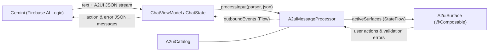

# Overview

Most AI agent responses in mobile apps today are trapped in walls of Markdown text—hard to interact with and visually disconnected from the rest of your app. **Generative UI** lets an agent construct task-specific interfaces at runtime (such as trip planners, reservation forms, and interactive rating cards) tailored to a user's prompt.

**A2UI (Agent-to-UI)** is an open, declarative JSON protocol ([a2ui.org](https://a2ui.org), shown at **v0.9** in this tutorial) for streaming agent-generated UIs safely to client apps:

- **Declarative & Safe by Design**: The agent never sends executable code or WebViews. Instead, it emits JSON messages referencing only the components and functions declared in your app's **Catalog**.
- **Native Jetpack Compose & Material 3**: The `androidx.compose.material3:material3-a2ui` library renders A2UI surfaces as real Compose nodes that automatically inherit your `MaterialTheme` (colors, typography, shapes, dark mode) and Android accessibility semantics (TalkBack, font scaling, keyboard navigation).
- **Reactive & Bidirectional**: Surfaces support progressive streaming placeholders, local Compose Snapshot two-way data binding, fine-grained server-to-client state patches, client-to-server user actions, and automatic validation error self-correction loops.

## Core Concepts & Architecture

Integrating A2UI into an Android app revolves around **three building blocks**:

1. **Catalog (`A2uiCatalog`)**: The contract defining which UI **Components** (`Text`, `Image`, `Card`, `Tabs`, `List`, `Button`, `Slider`, etc.) and client **Functions** (`formatString`, `formatCurrency`, `pluralize`, `openUrl`, etc.) the agent is allowed to use.
2. **Message Processor (`A2uiMessageProcessor`)**: Receives raw A2UI JSON messages from your streaming chat session via an `A2uiMessageParser`, validates them against your `A2uiCatalog` off the main thread, maintains reactive surface models (`activeSurfaces`), and emits user actions and validation errors (`outboundEvents`).
3. **Surface (`A2uiSurface`)**: A `@Composable` container that renders each validated surface model in your UI.



## What You'll Build

In this tutorial, you'll take an Android chat app powered by **Firebase AI Logic** and **Jetpack Compose** and progressively upgrade it from plain-text responses to rich, interactive, custom-branded **A2UI** surfaces:

1. Connect the starter app to **Firebase AI Logic** and **Firebase App Check**, and observe plain-text Gemini responses.
2. Create the Material 3 Basic Catalog (`createCatalog`) with media renderers and add A2UI system instructions so Gemini responds with A2UI v0.9 JSON messages over the wire.
3. Wire up `A2uiCatalog`, `A2uiMessageProcessor`, and `A2uiSurface` to render native Material 3 Compose UIs in real time.
4. Collect `processor.outboundEvents` to forward user actions back to Gemini and enable automatic `VALIDATION_FAILED` self-correction.
5. Override the Basic Catalog `Button` component with a custom shiny gradient `CustomButton` from your own design system.
6. Build a brand-new `StarRating` A2UI component, extend the catalog, and dynamically export its JSON Schema to Gemini.

---

# Step 1: Project setup

## Clone the repository

1. Clone the `devrel-demos` repository to your development machine:

   ```bash
   git clone https://github.com/GoogleCloudPlatform/devrel-demos.git
   ```

2. Open **Android Studio** (use the latest Canary/Preview build with support for Android Gradle Plugin `9.2` and `compileSdk` `37.1`), select **Open**, and open the **`devrel-demos/codelabs/a2ui-android`** directory.
3. Wait for Gradle sync to finish. Notice that the A2UI integration points in the project are marked with `// TODO(developer): Step #...` comments that you will enable step by step.

## Configure Firebase AI Logic and Firebase App Check

### Why Firebase AI Logic and App Check?

- **Firebase AI Logic** lets you call Gemini models directly from your Android app using the Firebase SDK—streaming text and A2UI JSON responses without having to build a custom backend proxy or embed raw API keys in your APK.
- **Firebase App Check** helps protect your Gemini API quota and backend resources from abuse by verifying that incoming requests originate from your authentic app (`Play Integrity` in release builds, and `DebugAppCheckProviderFactory` during local development).

### 1. Enable Firebase AI Logic & register your Android app

1. Open the [Firebase Console](https://console.firebase.google.com/) and create a new Firebase project (or select an existing one).
2. In the left navigation menu, go to **Build > AI Logic**, click **Get started**, and enable the **Gemini Developer API** (which includes a no-cost tier ideal for prototyping and codelabs).
3. Go to **Project Overview**, click **Add app**, and select **Android**.
4. Register the app using the exact package name below:

   ```text
   dev.thatfire.composea2ui
   ```

5. Download the generated **`google-services.json`** file and place it inside the **`app/`** directory (`codelabs/a2ui-android/app/google-services.json`).

### 2. Run the app & register your App Check debug token

Debug builds automatically install `DebugAppCheckProviderFactory` at startup (see `ChatApplication.kt` and `app/src/debug/java/dev/thatfire/composea2ui/AppCheckInstaller.kt`).

1. Run the **`app`** configuration on an Android emulator or physical device with internet access.
2. Open **Logcat** in Android Studio and filter by **`DebugAppCheckProvider`** (you may need to send a quick test message in the chat first to trigger token generation). Copy the UUID debug secret printed in Logcat:

   ```text
   D DebugAppCheckProvider: Enter this debug secret into the allow list in the Firebase Console for your project: XXXXXXXX-XXXX-XXXX-XXXX-XXXXXXXXXXXX
   ```

3. In the [Firebase Console](https://console.firebase.google.com/), navigate to **Build > App Check** (click **Get started** if prompted).
4. Under the **Apps** tab, locate **`dev.thatfire.composea2ui`**, open the overflow menu (**⋮**), and click **Manage debug tokens**.
5. Click **Add debug token**, enter a label (for example, `Dev Emulator`), paste the debug secret from Logcat, and click **Save**.
6. Under the **APIs** tab in App Check, you can optionally enforce App Check for **Firebase AI Logic**.

### 3. Try the initial plain-text chat

With `google-services.json` and App Check configured, send a prompt in the app such as:

> *"Plan a weekend trip to Tokyo"*

Because we haven't taught the model about A2UI yet, Gemini responds with a long wall of plain text in the chat bubble. Let's change that!

---

# Step 2: Get A2UI responses

## What the Agent Streams Over the Wire

To generate UI, we provide Gemini with a **system instruction** (`buildSystemInstruction(...)` in `app/src/main/java/dev/thatfire/composea2ui/a2ui/SystemInstruction.kt`) containing:

- Behavioral rules instructing the model to reply with a brief conversational sentence followed by standalone fenced `json` code blocks.
- The A2UI v0.9 server-to-client message schema (`createSurface`, `updateComponents`, `updateDataModel`, `deleteSurface`) and common types schema.
- The JSON Schema serialized directly from your app's `A2uiCatalog` (`catalog.toJsonSchemaString()`).
- Few-shot examples referencing your catalog's `catalogId`.

When prompted with *"Plan a weekend trip to Tokyo"*, the LLM streams conversational text followed by A2UI v0.9 JSON protocol messages (`createSurface` and `updateComponents`) targeting your catalog:

```json
{
  "version": "v0.9",
  "createSurface": {
    "surfaceId": "tokyo-weekend-planner",
    "catalogId": "https://a2ui.org/specification/v0_9/catalogs/basic/catalog.json"
  }
}
```

```json
{
  "version": "v0.9",
  "updateComponents": {
    "surfaceId": "tokyo-weekend-planner",
    "components": [
      {
        "id": "root",
        "component": "Card",
        "child": "planner-col"
      },
      {
        "id": "planner-col",
        "component": "Column",
        "children": [
          "header-image",
          "title-text",
          "planner-tabs"
        ],
        "align": "stretch"
      }
    ]
  }
}
```

## 1. Create the Component Catalog & Plug In Media Renderers

Before building the system instruction, we need to define our app's **`A2uiCatalog`** so A2UI can serialize its JSON Schema (`catalog.toJsonSchemaString()`) into Gemini's prompt.

Most Material 3 Basic Catalog components (`Text`, `Card`, `Row`, `Column`, `List`, `Tabs`, `Slider`, `ChoicePicker`, `DateTimeInput`, `Button`, `TextField`, etc.) work out of the box via `materialA2uiBasicCatalogV1(...)`. Because the Basic Catalog leaves network image loading and video/audio playback unopinionated, you only need to plug in:

- **`image`**, **`video`**, and **`audioPlayer`** renderers via `MaterialA2uiBasicCatalogV1Defaults` (the starter project provides `CoilA2uiImageRenderer` using Coil 3 and `Media3A2uiVideoRenderer` / `Media3A2uiAudioPlayerRenderer` using AndroidX Media3).
- **`functions`** via `A2uiBasicCatalogV1.Functions(context)` for standard client-side catalog functions (such as `formatString` and `openUrl`).

Open **`app/src/main/java/dev/thatfire/composea2ui/a2ui/catalog/ChatCatalog.kt`**, locate `// TODO(developer): Step #2`, and implement `createCatalog(context)` (replacing the `TODO(...)` placeholder):

```kotlin
fun createCatalog(context: Context): A2uiCatalog {
    // TODO(developer): Step #2 - Configure the Material 3 Basic Catalog and media renderers
    val basicCatalog = materialA2uiBasicCatalogV1(
        image = MaterialA2uiBasicCatalogV1Defaults.image(CoilA2uiImageRenderer),
        video = MaterialA2uiBasicCatalogV1Defaults.video(Media3A2uiVideoRenderer),
        audioPlayer = MaterialA2uiBasicCatalogV1Defaults.audioPlayer(Media3A2uiAudioPlayerRenderer),
        functions = A2uiBasicCatalogV1.Functions(context),
    )

    return basicCatalog
}
```

## 2. Add `systemInstruction` to `ChatViewModel`

Next, open **`app/src/main/java/dev/thatfire/composea2ui/ChatViewModel.kt`**, locate `// TODO(developer): Step #2`, and add the `systemInstruction` parameter to `generativeModel`:

```kotlin
    private val generativeModel = Firebase.ai(backend = GenerativeBackend.googleAI())
        .generativeModel(
            modelName = "gemini-3.5-flash-lite",
            // TODO(developer): Step #2 - Add A2UI system instructions
            systemInstruction = content {
                text(buildSystemInstruction(application))
            },
        )
```

> [!NOTE]
> `buildSystemInstruction(application)` calls `createCatalog(application)` under the hood, exporting your catalog's component and function definitions via `catalog.toJsonSchemaString()`.

## Run the app

Re-run the app and send:

> *"Plan a weekend trip to Tokyo"*

Instead of a wall of prose, you'll now see Gemini stream a concise introduction followed by raw A2UI v0.9 `createSurface` and `updateComponents` JSON blocks directly in the chat window! Next, let's turn that JSON into live Jetpack Compose UI.

---

# Step 3: Render the Compose UI

## Connect `A2uiCatalog`, `A2uiMessageProcessor`, and `A2uiMessageParser`

Open **`app/src/main/java/dev/thatfire/composea2ui/ChatViewModel.kt`** and complete the four `// TODO(developer): Step #3` sections:

1. **Instantiate `catalog`, `processor`, and `parser`** at the top of `ChatViewModel` (and pass `catalog` into `buildSystemInstruction(application, catalog)` so both share the same instance):

   ```kotlin
   // TODO(developer): Step #3 - Instantiate catalog, processor, and parser
   private val catalog = createCatalog(application)
   private val processor = A2uiMessageProcessor(catalogs = listOf(catalog))
   private val parser = A2uiMessageParser()

   private val generativeModel = Firebase.ai(backend = GenerativeBackend.googleAI())
       .generativeModel(
           modelName = "gemini-3.5-flash-lite",
           // TODO(developer): Step #2 - Add A2UI system instructions
           systemInstruction = content {
               text(buildSystemInstruction(application, catalog))
           },
       )
   ```

2. **Configure `ChatState` to listen to `activeSurfaces` and process A2UI JSON messages** extracted from the stream:

   ```kotlin
   private val chatState = ChatState(
       scope = viewModelScope,
       // TODO(developer): Step #3 - Listen to activeSurfaces and process A2UI JSON messages
       surfaces = processor.activeSurfaces,
       onA2uiMessage = { json -> processor.processInput(parser, json) },
   )
   ```

3. **Process incoming A2UI messages off the main thread** inside `init`:

   ```kotlin
   init {
       // TODO(developer): Step #3 - Process incoming A2UI messages off the main thread
       viewModelScope.launch(Dispatchers.Default) {
           processor.collectMessages()
       }
   }
   ```

4. **Clear active A2UI surfaces in `clearChat()`** when resetting the conversation:

   ```kotlin
   fun clearChat() {
       chatState.clear()
       // TODO(developer): Step #3 - Clear active A2UI surfaces
       processor.clearSurfaces()
       chat = generativeModel.startChat()
   }
   ```

> [!IMPORTANT]
> `processor.processInput(parser, json)` only enqueues incoming messages. Make sure you launch a coroutine calling `processor.collectMessages()` (ideally on `Dispatchers.Default`); the processor validates and updates surfaces for as long as that coroutine remains active.

## How `ChatScreen` Renders `A2uiSurface`

In **`app/src/main/java/dev/thatfire/composea2ui/ChatScreen.kt`**, `ChatBubble` already renders each validated `A2uiSurfaceModel` attached to a model reply using the `A2uiSurface` composable:

```kotlin
message.surfaceModels.forEach { surfaceModel ->
    key(surfaceModel.id) {
        A2uiSurface(
            surfaceModel = surfaceModel,
            modifier = Modifier
                .fillMaxWidth()
                .heightIn(max = MaxSurfaceHeight),
        )
    }
}
```

> [!NOTE]
> Always constrain `A2uiSurface` with a bounded maximum height (`Modifier.heightIn(max = MaxSurfaceHeight)`) when rendering inside a vertically scrollable parent such as `LazyColumn`. Because an agent can freely include scrollable `List` components inside a surface, unbounded vertical constraints would otherwise cause nested-scroll measurement crashes.

### What You Get Out of the Box

Once `A2uiMessageProcessor` and `A2uiSurface` are connected, the runtime automatically handles:

- **Progressive Rendering**: As soon as the root component arrives in the stream, `A2uiSurface` displays the container and renders shimmer placeholders for child IDs that haven't streamed in yet, animating children in with Material 3 motion as they arrive.
- **Snapshot-Backed Two-Way Data Binding**: Each surface maintains an in-memory data model backed by Compose `Snapshot` state. Dragging a `Slider` bound to `/partySize` updates both the slider and any `formatString` text (`"Table for 6 guests"`) **locally and instantaneously**, with zero network round-trips to the agent.
- **Fine-Grained Agent Updates (`updateDataModel`)**: When you ask to tweak a value in natural language, the agent doesn't need to regenerate the UI tree—it sends a compact `updateDataModel` patch that updates the existing surface in place:

  ```json
  {
    "version": "v0.9",
    "updateDataModel": {
      "surfaceId": "tokyo-dinner-booking",
      "path": "/partySize",
      "value": 6
    }
  }
  ```

## Run the app

Re-run the app and try these prompts:

1. Send *"Plan a weekend trip to Tokyo"* — watch the raw JSON disappear and transform into an interactive Material 3 `Card` with a lead Wikipedia photo, `Saturday` / `Sunday` `Tabs`, and scrollable `List` items!
2. Send *"Book a dinner table in Tokyo"* — drag the **Party size** `Slider` and watch `"Table for N guests"` update instantaneously, then send *"Make it 6 guests"* in the chat input to see Gemini update the slider in place via `updateDataModel`.

If you tap **Confirm Reservation** right now, nothing happens yet—let's wire up outbound client events in Step 4!

---

# Step 4: Handle User Actions & Validation Self-Correction

Communication in A2UI is **bidirectional**. When a user clicks an interactive component (like a `"Confirm Reservation"` button) or when the agent emits invalid component JSON, `A2uiMessageProcessor` publishes client-to-server messages on `processor.outboundEvents`.

## 1. Outbound User `action` Messages

When the user taps `"Confirm Reservation"`, the renderer resolves the action's `context` bindings against the surface's current in-memory data model and emits an `A2uiClientEventMessage`, which serializes to an A2UI `action` JSON payload:

```json
{
  "version": "v0.9",
  "action": {
    "name": "confirmReservation",
    "surfaceId": "tokyo-dinner-booking",
    "sourceComponentId": "reserve-btn",
    "timestamp": "2026-10-27T02:57:39.077Z",
    "context": {
      "partySize": 4,
      "time": [
        "19:30"
      ]
    }
  }
}
```

In this app, `ChatState.sendClientMessage(...)` displays user-triggered `action` payloads as a formatted JSON message in the chat timeline so you can inspect the exact payload sent back to Gemini.

## 2. Automatic Schema Validation & Agent Self-Correction

LLMs can occasionally hallucinate component names or malformed properties. Before any component reaches Compose UI, `A2uiMessageProcessor` validates it against your `A2uiCatalog`:

1. If a single component fails validation, the renderer isolates the error to just that component slot while the rest of the surface continues rendering normally.
2. Behind the scenes, `processor.outboundEvents` emits an `A2uiClientErrorMessage` (`VALIDATION_FAILED`):

   ```json
   {
     "version": "v0.9",
     "error": {
       "code": "VALIDATION_FAILED",
       "surfaceId": "tokyo-photos",
       "message": "Component type 'UnknownTypeThatDoesNotExist' not found in catalog",
       "path": "/components/unsupported-component"
     }
   }
   ```

3. Upon receiving this error via `sendClientMessage(it)`, Gemini automatically sends a follow-up `updateComponents` patch that repairs the broken component in place.

## Collect `processor.outboundEvents` in `ChatViewModel`

Open **`app/src/main/java/dev/thatfire/composea2ui/ChatViewModel.kt`**, locate `// TODO(developer): Step #4` inside `init`, and collect `processor.outboundEvents`:

```kotlin
    init {
        // TODO(developer): Step #3 - Process incoming A2UI messages off the main thread
        viewModelScope.launch(Dispatchers.Default) {
            processor.collectMessages()
        }

        // TODO(developer): Step #4 - Forward user actions and validation errors back to the agent
        viewModelScope.launch {
            processor.outboundEvents.collect { sendClientMessage(it) }
        }
    }
```

## Run the app

Re-run the app and test the full round-trip flow:

1. Send *"Book a dinner table in Tokyo"*.
2. Adjust the **Party size** slider and choose a **Seating time** option on the generated card.
3. Tap **Confirm Reservation**. You'll see the serialized `"action"` JSON payload appear in the chat with your selected `partySize` and `time`, followed by Gemini's confirmation response!

---

# Step 5: Override a Basic Catalog Component with Your Design System

If your app has its own design system, you can replace individual components in the Basic Catalog while keeping the standard A2UI component name, description, and JSON property schema intact.

The starter project already includes a custom **`CustomButton`** composable in **`app/src/main/java/dev/thatfire/composea2ui/ui/components/CustomButton.kt`** styled with a glossy, animated multi-stop gradient so you can immediately spot it when rendered inside an A2UI surface.

## 1. Implement `CustomButtonComponent`

Open (or create) **`app/src/main/java/dev/thatfire/composea2ui/a2ui/catalog/CustomButtonComponent.kt`** (`// TODO(developer): Step #5`) and implement `A2uiBasicCatalogV1.Button`. Because `A2uiBasicCatalogV1.Button` already defines the schema and validates incoming JSON properties, you only need to implement `A2uiComponentScope.TypedContent(...)`:

- Trigger the button's A2UI action using `dispatchAction(action)`.
- Resolve and render the button's child component (such as its `Text` label) using `observeA2uiComponentState(childId)` and `A2uiComponent(...)`.

```kotlin
package dev.thatfire.composea2ui.a2ui.catalog

import androidx.a2ui.compose.runtime.A2uiComponentScope
import androidx.a2ui.compose.runtime.A2uiComponentState
import androidx.a2ui.compose.ui.A2uiComponent
import androidx.a2ui.compose.ui.catalog.A2uiBasicCatalogV1
import androidx.compose.runtime.Composable
import androidx.compose.ui.Modifier
import dev.thatfire.composea2ui.ui.components.CustomButton

object CustomButtonComponent : A2uiBasicCatalogV1.Button {
    @Composable
    override fun A2uiComponentScope.TypedContent(
        childId: String,
        variant: A2uiBasicCatalogV1.Button.Variant,
        action: Map<String, Any?>,
        accessibility: A2uiBasicCatalogV1.AccessibilityAttributes?,
        checks: List<A2uiBasicCatalogV1.CheckRule>,
        modifier: Modifier,
    ) {
        val allChecksPassed = checks.all { it.condition }
        val childState = observeA2uiComponentState(childId)

        CustomButton(
            onClick = { dispatchAction(action) },
            enabled = allChecksPassed && childState is A2uiComponentState.Success,
            modifier = modifier,
        ) {
            if (childState is A2uiComponentState.Success) {
                A2uiComponent(childState.component)
            }
        }
    }
}
```

> [!TIP]
> `A2uiComponentState` exposes `Loading`, `Error`, and `Success` states. In custom containers or buttons, you can keep showing a loading indicator while `childState` is in an error state and waiting for the agent's self-correction loop to repair it—hiding transient LLM mistakes from the user.

## 2. Register the Override in `ChatCatalog`

Open **`app/src/main/java/dev/thatfire/composea2ui/a2ui/catalog/ChatCatalog.kt`**, locate `// TODO(developer): Step #5`, and pass `button = CustomButtonComponent` to `materialA2uiBasicCatalogV1(...)`:

```kotlin
fun createCatalog(context: Context): A2uiCatalog {
    val basicCatalog = materialA2uiBasicCatalogV1(
        image = MaterialA2uiBasicCatalogV1Defaults.image(CoilA2uiImageRenderer),
        video = MaterialA2uiBasicCatalogV1Defaults.video(Media3A2uiVideoRenderer),
        audioPlayer = MaterialA2uiBasicCatalogV1Defaults.audioPlayer(Media3A2uiAudioPlayerRenderer),
        functions = A2uiBasicCatalogV1.Functions(context),
        // TODO(developer): Step #5 - Override the Basic Catalog Button with CustomButtonComponent
        button = CustomButtonComponent,
    )

    return basicCatalog
}
```

## Run the app

Re-run the app and send:

> *"Book a dinner table in Tokyo"*

Notice that the **Confirm Reservation** button inside the generated A2UI card now renders with your shiny, animated multi-stop gradient `CustomButton`—without changing a single word of your prompt or system instructions!

---

# Step 6: Create a Brand-New Custom Component (StarRatingComponent)

Beyond overriding existing components, A2UI lets you invent domain-specific components that don't exist in the Basic Catalog—such as an interactive **`StarRating`** bar for rating restaurants.

The starter project already includes the Compose UI widget **`StarRating`** in **`app/src/main/java/dev/thatfire/composea2ui/ui/components/StarRating.kt`**. Now let's expose it to the A2UI runtime and to Gemini.

## 1. Implement `StarRatingComponent`

Open (or create) **`app/src/main/java/dev/thatfire/composea2ui/a2ui/catalog/StarRatingComponent.kt`** (`// TODO(developer): Step #6`) and implement the `A2uiComponent` interface:

1. **`name` & `description`**: Serialized directly into the JSON Schema sent to Gemini so the model knows what the component does and when to pick it.
2. **`properties` (`List<A2uiProperty<*>>`)**: Acts as a **single source of truth**—both generating the JSON Schema for the agent and extracting typed values at runtime:
   - `A2uiProperty.dynamicNumber(...)`: A property that can bind to a mutable JSON Pointer path in the surface's data model (for example, `{"path": "/places/0/userRating"}`).
   - `A2uiProperty.number(...)`: A static inline number property with a default value (for example, `"max": 5`).
3. **`A2uiComponentScope.Content(...)`**:
   - Read static properties via indexing: `properties[maxProperty]`.
   - Subscribe to reactive data-model values via `properties.bind(valueProperty)`.
   - Obtain a two-way mutation callback via `properties.bindUpdater(valueProperty)`.

```kotlin
package dev.thatfire.composea2ui.a2ui.catalog

import androidx.a2ui.compose.runtime.A2uiComponentProperties
import androidx.a2ui.compose.runtime.A2uiComponentScope
import androidx.a2ui.compose.runtime.A2uiProperty
import androidx.a2ui.compose.ui.A2uiComponent
import androidx.compose.runtime.Composable
import androidx.compose.ui.Modifier
import dev.thatfire.composea2ui.ui.components.StarRating

object StarRatingComponent : A2uiComponent {
    override val name: String
        get() = "StarRating"

    override val description: String
        get() = "A row of stars representing a rating. " +
            "Set the value to a path to let the user change it."

    private val valueProperty = A2uiProperty.dynamicNumber(
        key = "value",
        required = true,
        description = "The current rating value, 0 to max",
    )

    private val maxProperty = A2uiProperty.number(
        key = "max",
        defaultValue = 5,
        description = "Max number of stars to show",
    )

    override val properties: List<A2uiProperty<*>>
        get() = listOf(valueProperty, maxProperty)

    @Composable
    override fun A2uiComponentScope.Content(
        properties: A2uiComponentProperties,
        modifier: Modifier,
    ) {
        val max = properties[maxProperty]?.toInt() ?: 5
        val value = properties.bind(valueProperty)?.toInt() ?: 0
        val onValueChange = properties.bindUpdater(valueProperty)

        StarRating(
            rating = value,
            max = max,
            onRatingChange = onValueChange,
            modifier = modifier,
        )
    }
}
```

## 2. Extend the Catalog with a Custom `A2uiCatalog`

Open **`app/src/main/java/dev/thatfire/composea2ui/a2ui/catalog/ChatCatalog.kt`**, locate the `// TODO(developer): Step #6` sections, and wrap `basicCatalog` in a new `A2uiCatalog` with a unique `CUSTOM_CATALOG_ID` and `basicCatalog.components + StarRatingComponent` (replacing `return basicCatalog`):

```kotlin
const val CUSTOM_CATALOG_ID = "https://example.com/catalogv1"

fun createCatalog(context: Context): A2uiCatalog {
    val basicCatalog = materialA2uiBasicCatalogV1(
        image = MaterialA2uiBasicCatalogV1Defaults.image(CoilA2uiImageRenderer),
        video = MaterialA2uiBasicCatalogV1Defaults.video(Media3A2uiVideoRenderer),
        audioPlayer = MaterialA2uiBasicCatalogV1Defaults.audioPlayer(Media3A2uiAudioPlayerRenderer),
        functions = A2uiBasicCatalogV1.Functions(context),
        // TODO(developer): Step #5 - Override the Basic Catalog Button with CustomButtonComponent
        button = CustomButtonComponent,
    )

    // TODO(developer): Step #6 - Extend the catalog with StarRatingComponent
    return A2uiCatalog(
        catalogId = CUSTOM_CATALOG_ID,
        components = basicCatalog.components + StarRatingComponent,
        functions = basicCatalog.functions,
        themeSchema = basicCatalog.themeSchema,
    )
}
```

Because `buildSystemInstruction(...)` in **`SystemInstruction.kt`** dynamically serializes `catalog.toJsonSchemaString()` and injects `catalog.id` into the few-shot examples, Gemini automatically learns about `StarRating` and emits `createSurface` messages targeting `"https://example.com/catalogv1"`!

## Run the app

Re-run the app and send the prompt:

> *"Recommend three ramen places in Tokyo that I can rate"*

1. Gemini discovers `StarRating` from `catalog.toJsonSchemaString()` and generates a surface featuring three ramen recommendations, each with an interactive `StarRating` bound to the surface's data model, followed by a submit button rendered with your shiny gradient `CustomButton`.
2. Tap stars on each restaurant to update their ratings locally via two-way data binding (`properties.bindUpdater(valueProperty)`).
3. Tap the **Save / Submit Ratings** button to dispatch the `action` event—you'll see all of your updated star ratings sent in the JSON `context` payload in the chat and acknowledged by Gemini!

---

# Conclusion

Congratulations! You've built a complete Generative UI Android app with **Jetpack Compose A2UI** and **Firebase AI Logic**.

Along the way, you learned how to:

- Configure **Firebase AI Logic** and **Firebase App Check** to stream Gemini responses safely from an Android client.
- Prompt an LLM with A2UI v0.9 schemas and system instructions (`catalog.toJsonSchemaString()`) so it emits structured, declarative UI messages.
- Connect **`A2uiCatalog`**, **`A2uiMessageProcessor`**, and **`A2uiSurface`** to render progressive Material 3 Compose interfaces with local Snapshot two-way data binding and `updateDataModel` patches.
- Collect **`processor.outboundEvents`** to handle user `action` events and automatic `VALIDATION_FAILED` agent self-correction.
- Override Basic Catalog components (`CustomButtonComponent`) to match your own design system, and extend your catalog with brand-new domain components (`StarRatingComponent`).

## Learn More

- **Jetpack Compose A2UI Documentation**: [goo.gle/a2ui-compose-docs](https://goo.gle/a2ui-compose-docs)
- **Material 3 A2UI Demo**: [goo.gle/material3-a2ui-demo](https://goo.gle/material3-a2ui-demo)
- **Android AI Samples**: [github.com/android/ai-samples](https://github.com/android/ai-samples)
- **A2UI Open Protocol Specification**: [a2ui.org](https://a2ui.org)
- **Video — Let agents generate UI in your Android apps with A2UI**: [youtube.com/watch?v=qIvsFGvlHdo](https://www.youtube.com/watch?v=qIvsFGvlHdo)
- **Firebase AI Logic Documentation**: [firebase.google.com/docs/ai-logic](https://firebase.google.com/docs/ai-logic)
- **Firebase App Check Documentation**: [firebase.google.com/docs/app-check](https://firebase.google.com/docs/app-check)
- **A2UI Compose Issue Tracker & Feedback**: [goo.gle/a2ui-compose-bug](https://goo.gle/a2ui-compose-bug)
