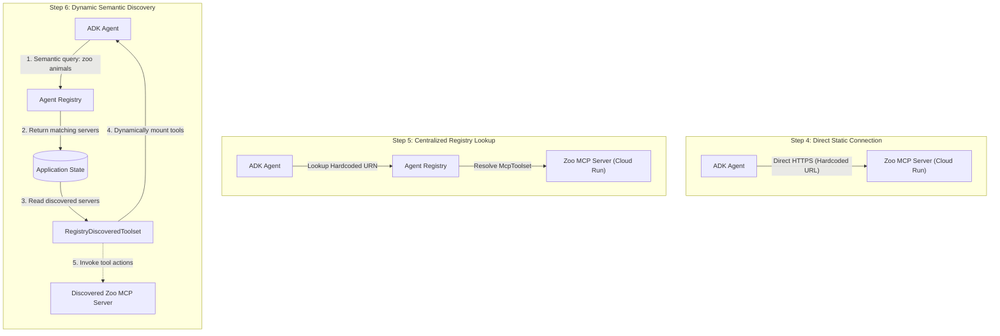

# Dynamic MCP Discovery with Google Cloud Agent Registry and ADK

Companion sample code for the **Dynamic MCP Discovery with Google Cloud Agent Registry and ADK** codelab.

## Overview

This codelab demonstrates how to leverage Google Cloud **Agent Registry** for dynamic discovery of **Model Context Protocol** (MCP) servers using the **Google Agent Development Kit** (ADK).

The project walks through an architectural evolution across incremental steps, illustrating the transition from hardcoded infrastructure endpoints to fully decoupled, semantic runtime discovery powered by Google Cloud [Agent Registry](https://docs.cloud.google.com/agent-registry/overview):

1. **MCP Server on Cloud Run**: Containerizing a domain-specific FastMCP server for Cloud Run with IAM protection and registering it in Agent Registry.
2. **Static Direct MCP**: Connecting an ADK agent directly to a known Cloud Run service URL with an ID token from Application Default Credentials (ADC), supplied through a `header_provider`.
3. **Registry Lookup (Static URN)**: Resolving the MCP server's toolset from Agent Registry via a known URN, eliminating direct endpoint URL references.
4. **Dynamic Semantic Discovery**: Eliminating all hardcoded server identifiers. The agent dynamically searches the registry using semantic queries (`search_mcp_servers`), caches discoveries in application state, and mounts tools at runtime via a custom dynamic toolset.

## Directory Structure & Step Progression

| Step | Path | Description | Infrastructure Coupling |
| :--- | :--- | :--- | :--- |
| **Step 3** | [`steps/step3/`](./steps/step3) | **FastMCP Server on Cloud Run:** Implements zoo animal tools (`list_species`, `get_animals_by_species`, `get_animal_details`) with read-only annotations. Containerized via Docker and `uv` for deployment on Cloud Run. | Server implementation |
| **Step 4** | [`steps/step4/`](./steps/step4) | **Static Direct MCP Connection:** Agent connects directly to `MCP_SERVER_URL` via `McpToolset` and a custom `header_provider` that attaches an ID token to every call to the MCP server. | Hardcoded service URL |
| **Step 5** | [`steps/step5/`](./steps/step5) | **Registry Lookup via Static URN:** Uses `AgentRegistry` to look up the server matching `MCP_SERVER_URN`. Abstracted endpoint URL, but still requires hardcoded server identifier. | Hardcoded MCP Server URN |
| **Step 6** | [`steps/step6/`](./steps/step6) | **Dynamic Semantic Discovery:** Zero hardcoded endpoints or URNs. Uses `discover_zoo_mcp_servers` to query the registry semantically and a custom `RegistryDiscoveredToolset` to dynamically mount tools into the agent. | **Fully Decoupled** (Dynamic runtime discovery) |

## Architectural Evolution



## Key Components in Step 6

- **Semantic Discovery Tool (`discover_zoo_mcp_servers`)**:
  Calls `AgentRegistry.search_mcp_servers(search_string=query, search_type="SEMANTIC")` to query available MCP servers dynamically without prior knowledge of server names or identifiers.
- **Dynamic Toolset (`RegistryDiscoveredToolset`)**:
  Implements an ADK `BaseToolset` subclass with `self._use_invocation_cache = False`. This ensures the agent evaluates discovered tools dynamically across conversation turns rather than caching an empty initial tool list.
- **Per-Server Authorization**:
  `_build_toolset()` creates a dedicated `AgentRegistry` and `_GoogleAuthHeaders` header provider for each discovered server and binds the ID token audience to that server's Cloud Run URL. The shared registry used for search has no header provider because Agent Registry API calls are authenticated with ADC automatically.
- **Application-Scoped State & Retention**:
  Stores discovered server records in `ToolContext.state["app:zoo_mcp_servers"]` with a 24-hour TTL (`DISCOVERY_TTL_SECONDS`) for automatic retention and rediscovery.
- **Fault Isolation & Session Management**:
  Safely isolates unreachable or failing servers during tool resolution (`asyncio.gather`) and provides clean async lifecycle termination (`close()`).
- **Adaptive Agent Instruction (`zoo_guide_instruction`)**:
  Dynamically steers the agent to execute discovery on initial turns, switching seamlessly to answering visitor questions once tools are active.

## Prerequisites

1. **Google Cloud Project**:
   - Billing enabled.
   - Required APIs enabled: Cloud Run (`run.googleapis.com`), Cloud Build (`cloudbuild.googleapis.com`), Vertex AI (`aiplatform.googleapis.com`), and Agent Registry (`agentregistry.googleapis.com`).
2. **Python Environment**:
   - Python `>=3.13`
   - [uv](https://docs.astral.sh/uv/)
   - [`jq`](https://jqlang.org/) (used to generate the MCP tool specification in Step 3)
3. **Google Cloud CLI**:
   - `gcloud` installed and authenticated (see [Google ADC Authentication Setup](#google-adc-authentication-setup-required-for-steps-46)).

## Configuration

Each agent step directory contains a `.env.example` file illustrating the required environment variables:

| Variable | Step 4 | Step 5 | Step 6 | Description |
| --- | :---: | :---: | :---: | --- |
| `GOOGLE_CLOUD_LOCATION` | **Required** | **Required** | **Required** | Gemini endpoint location; set to `global`. Steps 5 and 6 also use it as the Agent Registry location where the MCP server is registered (`global`). |
| `GOOGLE_CLOUD_PROJECT` | **Required** | **Required** | **Required** | Google Cloud Project ID |
| `GOOGLE_CLOUD_PROJECT_NUMBER` | — | **Required** | — | Google Cloud Project Number (used to build the MCP server URN) |
| `GOOGLE_GENAI_USE_ENTERPRISE` | **Required** | **Required** | **Required** | Set to `TRUE` to route through Vertex AI |
| `MCP_SERVER_URL` | **Required** | — | — | Deployed Cloud Run MCP server URL (without the `/mcp` path) |

Notice how **Step 6** eliminates the need for `MCP_SERVER_URL`, `GOOGLE_CLOUD_PROJECT_NUMBER`, and server URNs, requiring only the standard Google Cloud project and location settings.

## Execution Guide

### Google ADC Authentication Setup (Required for Steps 4–6)

The ADK agents in Steps 4 through 6 use Google Application Default Credentials (ADC) to authenticate requests to Cloud Run, Agent Registry, and Gemini / Vertex AI.

Calls to the Cloud Run MCP server use an ID token that identifies your user account:

- **In Cloud Shell**, the agents get the ID token from the Cloud Shell metadata server. No additional setup is required.
- **In a local terminal**, the agents use the ID token from your user ADC, created with `gcloud auth application-default login`.

> [!NOTE]
> ID tokens from user credentials are intended for development and testing. In production, call Cloud Run services with a service account identity. See [Authenticating developers](https://cloud.google.com/run/docs/authenticating/developers).

Set up your credentials before running any agent:

```bash
# 1. Authenticate gcloud CLI (skip in Cloud Shell)
gcloud auth login

# 2. Acquire Application Default Credentials (skip in Cloud Shell)
gcloud auth application-default login

# 3. Set your active Google Cloud project
gcloud config set project <PROJECT_ID>
```

### Step 3: Deploy the MCP Server to Cloud Run and Register It in Agent Registry

In Step 3, you containerize and deploy the FastMCP server to Google Cloud Run, and then register it in Agent Registry.

1. **Enable required services**:

   ```bash
   gcloud services enable run.googleapis.com cloudbuild.googleapis.com \
     aiplatform.googleapis.com agentregistry.googleapis.com
   ```

2. **Deploy to Cloud Run**:

   ```bash
   cd steps/step3

   gcloud run deploy zoo-mcp-server \
     --source . \
     --region us-west1 \
     --labels=dev-tutorial=codelab-dynamic-mcp-discovery \
     --invoker-iam-check \
     --no-allow-unauthenticated
   ```

   **Key flags**:
   - `--invoker-iam-check`: Explicitly enforces the IAM check for the `run.routes.invoke` permission on every request.
   - `--no-allow-unauthenticated`: Enforces IAM authentication on the service endpoint (protecting it from public access and requiring caller ID tokens).

3. **Register the MCP server in Agent Registry**:

   ```bash
   uv sync
   uv run fastmcp inspect server.py --format mcp | jq 'del(..|nulls) | del(.tools[]?._meta?)' > toolspec.json
   MCP_URL=$(gcloud run services describe zoo-mcp-server --region=us-west1 --format='value(status.url)')
   gcloud agent-registry services create zoo-mcp-server \
       --display-name="zoo-mcp-server" \
       --project="${GOOGLE_CLOUD_PROJECT}" \
       --location=global \
       --mcp-server-spec-type="tool-spec" \
       --mcp-server-spec-content="toolspec.json" \
       --interfaces="url=${MCP_URL}/mcp,protocolBinding=jsonrpc"
   ```

   > [!NOTE]
   > Deploying with the `--functional-type=mcp-server` flag would register the MCP server automatically,
   > but in the same location as the deployment region. Discovering the server would then require
   > knowledge about the deployment region of the MCP server, which isn't always available.

4. **Grant your user account permission to call the MCP server**:

   ```bash
   gcloud run services add-iam-policy-binding zoo-mcp-server \
     --region=us-west1 \
     --member=user:$(gcloud config get-value account) \
     --role='roles/run.invoker'
   ```

   If you are the project owner, you already have this permission.

5. **Verify registration and note service details**:
   - Note the **Service URL** printed by the deployment (or the `MCP_URL` value above). You will need this URL for Step 4.
   - Verify that the server is registered in Agent Registry:

     ```bash
     gcloud agent-registry mcp-servers list --location=global
     ```

### Step 4: Run Agent with Direct Static MCP Connection

In Step 4, the agent connects directly to the Cloud Run service URL. A `header_provider` attaches an ID token to every request to the MCP server.

1. **Navigate to Step 4 and configure environment**:

   ```bash
   cd steps/step4
   cp zoo_agent/.env.example zoo_agent/.env
   ```

   Open `zoo_agent/.env` and fill in:
   - `GOOGLE_CLOUD_PROJECT`: Your project ID
   - `MCP_SERVER_URL`: The Cloud Run service URL from Step 3

2. **Install dependencies**:

   ```bash
   uv sync
   ```

3. **Run the agent**:

   ```bash
   # CLI mode:
   uv run adk run zoo_agent

   # Interactive web UI mode (run from steps/step4):
   uv run adk web
   ```

### Step 5: Run Agent with Registry Lookup via Static URN

In Step 5, the agent delegates endpoint discovery to Agent Registry by resolving a known URN, removing direct URL dependencies.

1. **Navigate to Step 5 and configure environment**:

   ```bash
   cd steps/step5
   cp zoo_agent/.env.example zoo_agent/.env
   ```

   Open `zoo_agent/.env` and fill in:
   - `GOOGLE_CLOUD_PROJECT`: Your project ID
   - `GOOGLE_CLOUD_PROJECT_NUMBER`: Your numeric project number
   - `GOOGLE_CLOUD_LOCATION`: Keep `global`, the location where the MCP server is registered

   *(Note: `MCP_SERVER_URL` is no longer needed).*

2. **Install dependencies**:

   ```bash
   uv sync
   ```

3. **Run the agent**:

   ```bash
   # CLI mode:
   uv run adk run zoo_agent

   # Interactive web UI mode (run from steps/step5):
   uv run adk web
   ```

   The agent sees the MCP tools with a prefix derived from the server's display name, for example `zoo_mcp_server_get_animals_by_species`.

### Step 6: Run Agent with Dynamic Semantic Discovery

In Step 6, the agent dynamically searches the registry using semantic queries (`search_mcp_servers`) and mounts the discovered tools on the fly. Neither service URLs nor server URNs are hardcoded.

1. **Navigate to Step 6 and configure environment**:

   ```bash
   cd steps/step6
   cp zoo_agent/.env.example zoo_agent/.env
   ```

   Open `zoo_agent/.env` and verify:
   - `GOOGLE_CLOUD_PROJECT`: Your project ID

   *(Note: No server URLs, project numbers, or URN identifiers are required).*

2. **Install dependencies**:

   ```bash
   uv sync
   ```

3. **Run the agent**:

   ```bash
   # CLI mode:
   uv run adk run zoo_agent

   # Interactive web UI mode (run from steps/step6):
   uv run adk web
   ```

4. **Test dynamic discovery**:
   In your chat session with the agent, ask questions such as:
   - *"How many animals are in the zoo?"*
   - *"Tell me about the lions in Big Cat Plains."*

   Observe the execution flow:
   1. The agent calls `discover_zoo_mcp_servers` to query the registry with semantic search.
   2. `RegistryDiscoveredToolset` resolves and mounts the discovered tools into the active context.
   3. The agent uses the discovered tools, such as `zoo_mcp_server_list_species`, `zoo_mcp_server_get_animals_by_species`, and `zoo_mcp_server_get_animal_details`, to answer your query.
