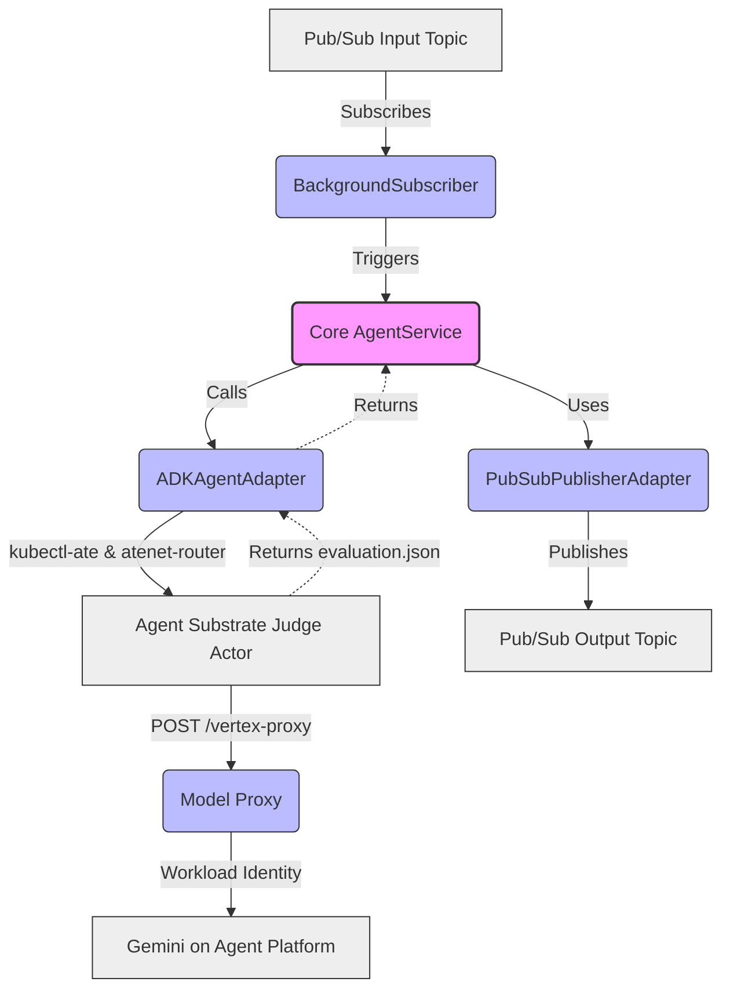

# Hackathon Judge Orchestrator (`agent`)

A production-ready Python application that listens to a Google Cloud Pub/Sub subscription, orchestrates isolated repository evaluations inside ephemeral **Agent Substrate** (`v1.0.0`) **Judge Actors** using a Google ADK agent, proxies model inference requests to **Gemini on Agent Platform**, and publishes **Evaluation Results** back to Pub/Sub.

Built with **FastAPI**, **Google Cloud Pub/Sub**, and **ADK**, structured using **Hexagonal Architecture (Ports and Adapters)**.

## Prerequisites

- Python 3.12+
- [uv](https://github.com/astral-sh/uv) (Python package manager)

## Installation

1. Make sure you have `uv` installed.
2. Install the project dependencies and sync the environment:
   ```bash
   uv sync
   ```

## Running the Application

You can run the FastAPI application using `uv`. The application starts a background Pub/Sub subscriber and exposes the internal **Model Proxy** (`/vertex-proxy`) during its lifecycle.

```bash
uv run python src/main.py
```

Alternatively, run it directly with `uvicorn` for live-reloading during development:

```bash
uv run uvicorn src.main:app --reload
```

The API will be available at `http://localhost:8000`.
- Health check endpoint: `http://localhost:8000/health`
- Model Proxy endpoint (for zero-credential Judge Actors): `POST /vertex-proxy/{upstream_path}`

## Agent Substrate Configuration

For each **Judging Task**, the Judge Orchestrator provisions a fresh ephemeral **Judge Actor** (`judge-<uuid>`) from an **Agent Substrate** **ActorTemplate** (**Golden Snapshot**), attaches a per-actor **EgressPolicy**, communicates with the actor over mTLS through `atenet-router`, and deletes both the actor and its egress policy in a `finally:` block:

- `SANDBOX_TEMPLATE` (default `judge-sandbox`, falls back to `SANDBOX_WARMPOOL` for backward compatibility): name of the Agent Substrate `ActorTemplate` to restore Judge Actors from.
- `SANDBOX_NAMESPACE` (default `hackathon-judge`): namespace/atespace where the `ActorTemplate` and Judge Actors live.
- `SANDBOX_CONNECTION_METHOD`: `router` (default; in-cluster over mTLS via `atenet-router.ate-system.svc.cluster.local:443`).
- `SANDBOX_ROUTER_URL` (optional): override the router URL (default `https://atenet-router.ate-system.svc.cluster.local:443`).
- `MODEL_PROXY_BASE_URL` (optional): base URL injected into the Judge Actor so `app.judge` routes Gemini model calls through the orchestrator's Model Proxy (default `http://agent.hackathon-judge.svc.cluster.local:8000/vertex-proxy`).

## Running Tests

The project uses `pytest` for testing. To run the full test suite:

```bash
uv run pytest
```

## Architecture Overview



This project follows a Hexagonal Architecture to separate concerns and ensure testability:

- **`src/core/`**: Contains the Domain Models (`AgentRequest`, `AgentResponse`) and Ports/Interfaces (`MessagePublisher`, `AgentService`).
- **`src/adapters/`**: Integrations with external services.
  - **`inbound/`**: `BackgroundSubscriber` (listens to Pub/Sub and triggers the agent).
  - **`outbound/`**: `ADKAgentAdapter` / `substrate_client.py` (manages ephemeral Agent Substrate Judge Actors and communicates via `atenet-router`) and `PubSubPublisherAdapter` (publishes results back to Pub/Sub).
- **`src/vertex_proxy.py`**: Zero-credential Model Proxy that validates `generateContent` / `streamGenerateContent` paths and attaches the orchestrator's Google Cloud credentials.
- **`src/main.py`**: The composition root. It wires the adapters to the core ports and manages the application lifecycle using FastAPI.
