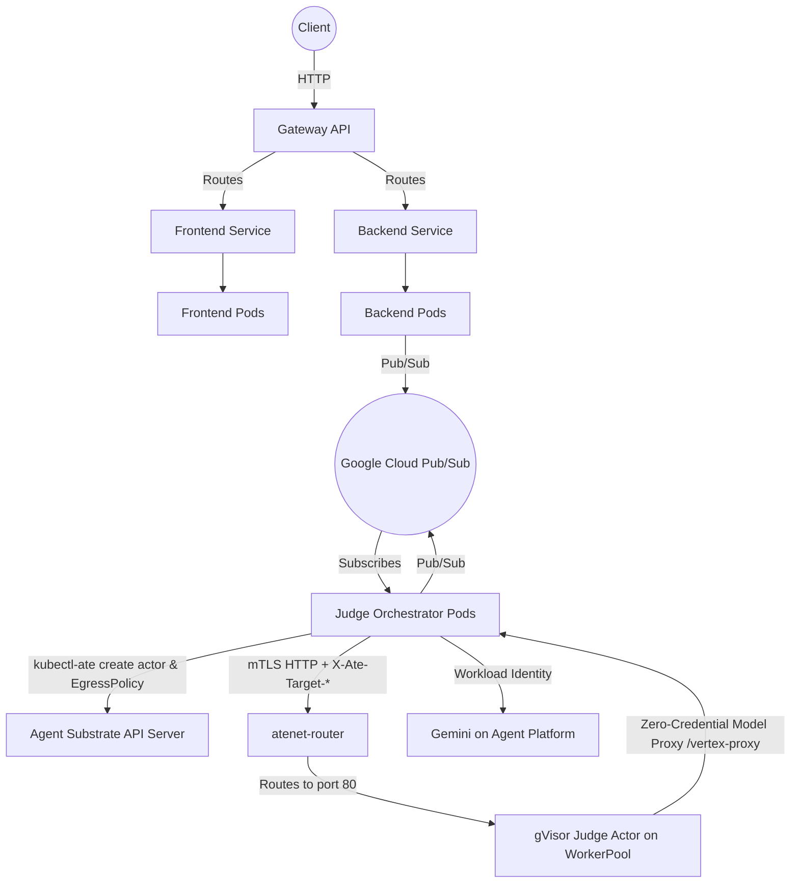

# Hackathon Judge Kubernetes & Agent Substrate Deployment

This directory contains the Kubernetes and **Agent Substrate** (`v1.0.0`) manifests required to deploy the Hackathon Judge application to a Google Kubernetes Engine (GKE) Standard cluster with gVisor nodes.

## Architecture Diagram



## Components

- **Namespace & Identity (`namespace.yaml`, `service-account.yaml`, `rbac.yaml`, `access-policy.yaml`)**:
  - `namespace.yaml` creates `hackathon-judge` labeled with `ate.dev/api-access: "true"` so pods can reach `ate-system`.
  - `service-account.yaml` defines `hackathon-judge-sa` (Judge Actors run with zero credentials and no dedicated sandbox service account).
  - `rbac.yaml` and `access-policy.yaml` grant `hackathon-judge-sa` permissions to manage `ate.dev` resources (`actors`, `actortemplates`, `workerpools`, `egresspolicies`) and OpenFGA `editor` access in the `hackathon-judge` atespace.
- **Agent Substrate Resources (`substrate.yaml`, `actortemplate.yaml`)**:
  - `WorkerPool` (`judge-workerpool`): 3 gVisor worker pods (`limits: 2000m CPU, 4608Mi memory`; `requests: 1000m CPU, 4608Mi memory`, providing `>= 64Mi` headroom above the `4Gi` actor limit).
  - `ActorTemplate` (`judge-sandbox`): memory-fidelity **Golden Snapshot** (`SNAPSHOT_FIDELITY_MEMORY`) configured with `egress-mitm.ate.dev` and `system-roots.ate.dev` trust bundles and `MODEL_PROXY_BASE_URL=http://agent.hackathon-judge.svc.cluster.local:8000/vertex-proxy`.
- **Judge Orchestrator (`agent.yaml`)**:
  - `Deployment/agent` mounts the `router-client` projected volume at `/run/router-client` (`ate-api-token`, `trust-bundle.pem`, and `credential-bundle.pem`) to authenticate over mTLS to `atenet-router`.
  - `Service/agent` exposes ports `8000` and `8082` in-cluster so **Judge Actors** can call the **Model Proxy** (`/vertex-proxy`) allowed by their per-actor **EgressPolicy**.
- **Backend, Frontend, Gateway & Config (`backend.yaml`, `frontend.yaml`, `gateway.yaml`, `configmap.yaml`)**: Core application deployments, services, external Gateway API routes, and environment configuration.

## Deployment

For a full automated setup (including GKE Standard cluster creation, Agent Substrate `v1.0.0` installation, Golden Snapshot creation, and service rollouts), run `./deploy-all.sh` from the repository root.

To apply the manifests manually against a cluster with Agent Substrate `v1.0.0` installed:

1. Load environment variables:
   ```bash
   source ./setup-env.sh
   ```

2. Apply the namespace, service account, RBAC, and ConfigMap:
   ```bash
   kubectl apply -f k8s/namespace.yaml
   kubectl apply -f k8s/service-account.yaml
   kubectl apply -f k8s/rbac.yaml
   envsubst < k8s/configmap.yaml | kubectl apply -f -
   ```

3. Apply the Agent Substrate `WorkerPool`, `atespace`, `AccessPolicy`, and `ActorTemplate` (**Golden Snapshot**):
   ```bash
   envsubst < k8s/substrate.yaml | kubectl apply -f -
   kubectl-ate create atespace hackathon-judge 2>/dev/null || true
   kubectl-ate create access-policy -a hackathon-judge -f k8s/access-policy.yaml
   envsubst < k8s/actortemplate.yaml | kubectl-ate create actor-template -f -
   ```

4. Deploy the Gateway, Backend, Frontend, and Judge Orchestrator (`agent`):
   ```bash
   kubectl apply -f k8s/gateway.yaml
   envsubst < k8s/backend.yaml | kubectl apply -f -
   envsubst < k8s/frontend.yaml | kubectl apply -f -
   envsubst < k8s/agent.yaml | kubectl apply -f -
   ```
