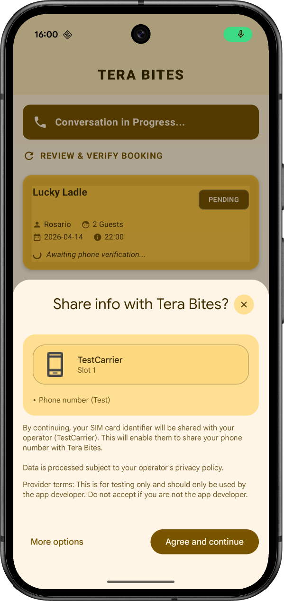

# Add Firebase Phone Number Verification to your Android app

This is the source code for the
[Add Firebase Phone Number Verification to your Android app codelab](https://firebase.google.com/codelabs/firebase-pnv-android).

<br>



## Requirements

- Android Studio (latest stable version). The project uses Android Gradle
  plugin 9.4 and Kotlin 2.4, which require JDK 17 or later.
- An Android device or emulator with Google Play services, running API level
  26 or higher. For emulators, use a system image that includes Google Play.
  Test mode doesn't need a real SIM.
- A Firebase project with an Android app registered for the package name
  `com.google.firebase.example.fpnv`. Download its `google-services.json` file
  into the `app/` directory. This file isn't checked into version control.

## Run the app in test mode

Test mode lets you verify a fake phone number without a billing account or a
real SIM.

1.  In the Firebase console, go to **Security** > **Phone Verification** >
    **Settings** >
    [**Testing** tab](https://console.firebase.google.com/project/_/phoneverification/settings/testing?useAutoProject=true),
    and click **Generate token**. To generate a token, you need the
    [Firebase Phone Number Verification Admin IAM role](https://docs.cloud.google.com/iam/docs/roles-permissions/fpnv#fpnv.admin).

1.  Add the token to the `local.properties` file in the root of this project.
    This file isn't checked into version control, so your token stays out of
    the repository:

    ```properties
    fpnv.testToken=COPIED_TOKEN_STRING
    ```

    On a CI server, you can set the `FPNV_TEST_TOKEN` environment variable
    instead.

1.  Build and run the debug variant of the app.

The app's Gradle file exposes the token to debug builds as
`BuildConfig.FPNV_TEST_TOKEN`. Release builds always get an empty value.
`TeraBitesApplication` enables the test session once per app process, and
only in debug builds. If the token is empty, the app logs a warning and test
mode stays off.

Test tokens expire after 7 days. When a token expires, verification fails and
the app tells you to generate a new token. Update `local.properties` and
rebuild the app.

## How the app handles errors

`ChatViewModel` calls `getVerifiedPhoneNumber()` and, if it fails, classifies
the exception (see `FpnvFailure.kt`) as described in
[Handle Firebase PNV errors on Android](https://firebase.google.com/docs/phone-number-verification/android/handle-errors):

| Failure | What the app does |
| --- | --- |
| The user declines consent (`CREDENTIAL_MANAGER_ERROR` caused by `GetCredentialCancellationException`) | Shows a message and a **Retry** button. Never retries automatically. |
| The test token is rejected or expired (`INVALID_TEST_NUMBER_ID`) | Tells you to generate a new test token and rebuild. |
| A `Context` that isn't an `Activity` was passed (`ACTIVITY_CONTEXT_REQUIRED`) | Shows an app error. This is a bug in the app. |
| Anything else, such as an unsupported carrier or a network error | Shows the error code and a **Retry** button. A production app would fall back to another verification method, such as SMS. |

## Run the unit tests

```shell
./gradlew testDebugUnitTest
```
